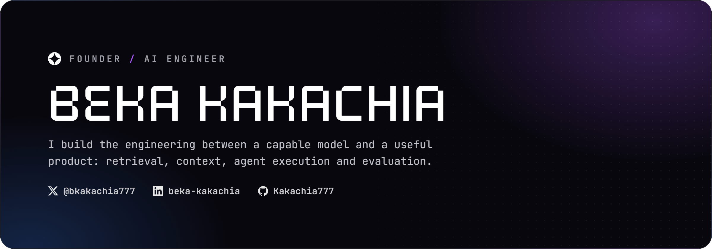
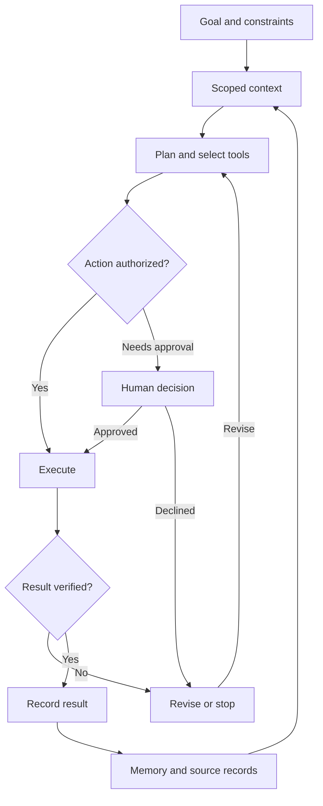

  <a href="https://syntrofai.com"><strong>SyntrofAI ↗</strong></a>
  &nbsp; / &nbsp;
  <a href="#engineering">Engineering</a>
  &nbsp; / &nbsp;
  <a href="#model-selection">Model selection</a>
  &nbsp; / &nbsp;
  <a href="https://docs.syntrofai.com">Product docs</a>
  &nbsp; / &nbsp;
  <a href="mailto:beka.kakachia777@gmail.com">Contact</a>

 

## Building SyntrofAI

I'm **Beka Kakachia**, founder of **[SyntrofAI](https://syntrofai.com)**. My focus is the engineering between a capable model and a useful product: **retrieval, context, agent execution, and evaluation**.

SyntrofAI is a **proprietary AI product** for people who want to hand over ongoing work. The source code is private; the public documentation explains the product's behavior:

| [Memory and retrieval][syntrofai-memory] | [Agent teams][syntrofai-teams] | [Models by role][syntrofai-models] |
| :--- | :--- | :--- |
| Durable knowledge, conversation history, scoped search, and editable continuity notes. | A coordinator, specialist agents, shared context, and configurable execution limits. | Separate models for main work, utility jobs, autonomous planning, recovery, and memory search. |

**[Explore the product →](https://syntrofai.com)** &nbsp; · &nbsp; [Why I'm building it](https://syntrofai.com/blog/why-i-built-syntrofai)

 

## Engineering

**Choose the best component for the constraint. Measure the system that results.**

My shortlist of GitHub repositories for building AI agents, with the problem each one fits. The selection notes express engineering criteria; the repositories belong to their respective maintainers and are not a list of SyntrofAI dependencies. Reviewed **19 October 2026**.

### Data and retrieval

| Component | Repositories I'd evaluate | Best fit / decision rule |
| :--- | :--- | :--- |
| **Document parsing** | [Docling][docling] · [Unstructured][unstructured] | Docling for layout, tables, and OCR; Unstructured for broad document partitioning. Test the hardest source files first. |
| **Web ingestion** | [Crawl4AI][crawl4ai] | Turning websites into Markdown and structured content for ingestion. Keep the source URL, capture time, and crawl scope. |
| **Chunking and RAG pipelines** | [Haystack][haystack] · [LlamaIndex][llamaindex] | Haystack for explicit component pipelines; LlamaIndex for its data and retrieval integrations. Preserve document structure through indexing. |
| **Embeddings** | [Qwen3-Embedding][qwen-embedding] · [FlagEmbedding][flagembedding] · [Sentence Transformers][sentence-transformers] | Qwen and BGE model families for a retrieval shortlist; Sentence Transformers for training and experimenting with embedding models. |
| **Vector databases** | **[LanceDB][lancedb]** · [pgvector][pgvector] · [Qdrant][qdrant] | Embedded multimodal data; vectors beside Postgres data; or a dedicated search service. Compare six options below. |
| **Lexical and hybrid search** | [OpenSearch][opensearch] · [Qdrant][qdrant] | OpenSearch for BM25 and a broader search stack; Qdrant for dense, sparse, and multi-vector retrieval. Measure exact terms and semantic matches separately. |
| **Reranking** | [Qwen3-Reranker][qwen-embedding] · [FlagEmbedding][flagembedding] · [Sentence Transformers][sentence-transformers] | Rescore a bounded candidate set when ranking quality justifies the extra inference. Benchmark the reranker independently. |
| **Graph retrieval** | [LightRAG][lightrag] · [Graphiti][graphiti] | LightRAG for graph-based document RAG; Graphiti for changing entities and relationships with temporal context. |

### Context and execution

| Component | Repositories I'd evaluate | Best fit / decision rule |
| :--- | :--- | :--- |
| **Working context and agent harness** | [Deep Agents][deepagents] · [Letta][letta] | Deep Agents bundles planning, filesystem tools, context management, and delegation; Letta centers stateful agents and persistent memory. |
| **Durable memory** | [Mem0][mem0] · [Graphiti][graphiti] · [Cognee][cognee] | Mem0 for an added memory layer; Graphiti for temporal facts; Cognee for graph-based knowledge pipelines. Test correction and deletion as well as recall. |
| **Agent orchestration** | [LangGraph][langgraph] · [Pydantic AI][pydantic-ai] | Explicit branching and checkpointed state, or typed Python tools and outputs. Pick the abstraction that makes failures easiest to inspect. |
| **Tool interfaces** | [MCP Python SDK][mcp] · [FastMCP][fastmcp] | The protocol SDK for direct control; FastMCP for building Python MCP servers, clients, and apps with less protocol plumbing. |
| **Browser execution** | [Playwright][playwright] · [Browser Use][browser-use] | Playwright for known, repeatable browser flows; Browser Use for model-directed interaction. Verify the final page state. |
| **Code execution** | [E2B][e2b] | Sandboxed execution for generated code. Set filesystem, network, secret, and runtime boundaries explicitly. |
| **Durable jobs and recovery** | [Temporal][temporal] | Long-running workflows that must recover after process failures. Design side effects for retries and idempotency. |

### Serving, evaluation, and product

| Component | Repositories I'd evaluate | Best fit / decision rule |
| :--- | :--- | :--- |
| **Model serving** | [vLLM][vllm] · [SGLang][sglang] · [llama.cpp][llamacpp] | Compare vLLM and SGLang for GPU serving; evaluate llama.cpp for local and quantized inference. Benchmark the actual model and hardware. |
| **Model gateway** | [LiteLLM][litellm] | A shared provider interface, routing, keys, and spend tracking. Validate each provider's tool and structured-output behavior. |
| **Content controls and PII** | [NeMo Guardrails][guardrails] · [Presidio][presidio] | Programmable conversational controls and sensitive-data detection/redaction. Evaluate coverage; keep authorization enforced in application code. |
| **Regression and RAG evaluation** | [Promptfoo][promptfoo] · [Ragas][ragas] | Promptfoo for repeatable prompt/model tests; Ragas for retrieval and response evaluation. Calibrate judges against reviewed examples. |
| **Prompt/program optimization** | [DSPy][dspy] | Optimize modular language-model programs against a defined metric. Keep a held-out set to detect overfitting. |
| **Tracing and experiments** | [Langfuse][langfuse] · [Phoenix][phoenix] | Trace inspection, datasets, and evaluation workflows. Choose around instrumentation and deployment requirements. |
| **Agent user experience** | [CopilotKit][copilotkit] | Shared application state, agent-facing UI, and human interaction. Make progress, approvals, and recoverable errors visible. |

<strong>01 / Vector databases — LanceDB and the alternatives I'd compare</strong>

 

| Repository | Where I'd reach for it | Trade-off to validate |
| :--- | :--- | :--- |
| **[LanceDB][lancedb]** | Embedded retrieval with vectors, metadata, and multimodal data on the Lance columnar format; a good fit to evaluate alongside Arrow, Pandas, or Polars workflows. | Validate concurrent access, indexing, and deployment needs. The local open-source library and managed cloud offerings are different deployment choices. |
| **[pgvector][pgvector]** | A product already running Postgres, where relational filters, joins, and vectors belong together. | Measure filtered recall and the impact of indexing and search on the main database. |
| **[Qdrant][qdrant]** | A dedicated retrieval service with dense, sparse, and multi-vector search. | Independent tuning and scaling add a service to operate; test filter selectivity and reranking under real load. |
| **[Milvus][milvus]** | Distributed vector workloads that justify a dedicated search deployment. Lite and standalone options also offer smaller entry points. | Validate the chosen deployment's operational cost, memory use, indexing, and recovery. |
| **[Chroma][chroma]** | Getting a retrieval application running quickly with collection-based APIs, in-memory or persistent local use, and a client/server option. | Check the exact deployment and feature set required as the workload grows. |
| **[Weaviate][weaviate]** | Object-and-vector search with hybrid retrieval, model integrations, and multi-tenancy features. | Compare integration convenience with configuration, resource use, and tenant-isolation requirements. |

**My decision order:** deployment constraints → data shape and filters → measured recall → latency under load → recovery and operating cost. A feature checklist or star count cannot choose the database for a workload.

<strong>02 / Retrieval and RAG — make every answer traceable to evidence</strong>

 

My starting hypothesis is a staged pipeline: preserve document structure, retrieve candidates, rerank when it helps, and answer from evidence. Compare each addition against a simpler baseline.

- **Ingest with structure.** Use [Docling][docling] or [Unstructured][unstructured] for documents and [Crawl4AI][crawl4ai] for web content. Preserve source IDs, versions, page or section references, and access scope.
- **Chunk for the questions.** Keep headings and tables meaningful. Compare chunk sizes and overlap using [Haystack][haystack] or [LlamaIndex][llamaindex] pipelines; more chunks do not automatically mean better evidence.
- **Retrieve both exact terms and meaning.** Compare lexical, dense, and hybrid retrieval. [OpenSearch][opensearch] provides a BM25 baseline; Qdrant's [hybrid search and reranking tutorial][hybrid-guide] is a concrete hybrid implementation reference.
- **Rerank selectively.** Evaluate [Qwen3 embedding/reranker models][qwen-embedding], [BGE models through FlagEmbedding][flagembedding], or [Sentence Transformers][sentence-transformers] on the corpus and languages that matter.
- **Add graphs when relationships change the answer.** Compare [LightRAG][lightrag] against the hybrid baseline. Include extraction and indexing cost in the result.
- **Evaluate retrieval separately from generation.** Better prose can conceal missing evidence. Preserve citations all the way to the final answer.

**Signals I'd track:** Recall@k, nDCG@k, citation correctness, unsupported-claim rate, p95 latency, and cost per supported answer. These are acceptance criteria, not reported SyntrofAI results.

**Maintenance matters.** [LlamaIndex's README][llamaindex] describes a company focus on document parsing while its open-source framework remains available. [Microsoft GraphRAG][graphrag] is a useful research reference, but its README says it is largely in maintenance mode and warns about indexing cost. Those facts belong in a dependency decision.

<strong>03 / Context engineering — keep the right state, retrieve the right evidence</strong>

 

I separate **working context**, **durable memory**, and **retrieved evidence**. Each has a different lifecycle.

| Layer | What belongs there | Design question |
| :--- | :--- | :--- |
| **Working context** | Current objective, constraints, plan, recent observations, unresolved decisions. | What must survive the next compaction? |
| **Durable memory** | Stable preferences, decisions, entities, and facts with provenance. | What is still true, what was superseded, and what may be forgotten? |
| **Retrieved evidence** | Task-relevant source passages and tool results. | Is it relevant, current, permission-scoped, and traceable? |

**References I'd evaluate**

- **[Deep Agents][deepagents]** for a harness with planning, filesystem access, context compaction, and delegation.
- **[Letta][letta]** for stateful agent and persistent-memory patterns; **[Mem0][mem0]** when adding a memory layer to an existing application.
- **[Cognee][cognee]** for turning documents and conversations into graph-based knowledge for retrieval.
- **[Graphiti][graphiti]** when changing relationships and historical validity matter. Its temporal graphs track facts over time; extraction quality and graph operations still need evaluation.
- **[Anthropic's context engineering guide][context-guide]** for selective retrieval, compaction, structured notes, and isolating subtask context.

My preferred compaction contract preserves the **goal, constraints, decisions, unfinished work, and source references**. Long tool output can be stored separately and retrieved again. I would test continuity after a reset and correction of an old fact, not just recall inside a single large prompt.

SyntrofAI's public [memory documentation][syntrofai-memory] describes its continuity notes, on-demand searches, current-user corrections, and separate memory workspaces.

<strong>04 / Agents and tools — explicit state, useful autonomy, recoverable execution</strong>

 

| Constraint | Reference | Engineering judgment |
| :--- | :--- | :--- |
| **Branching workflows, pause/resume, human decisions** | [LangGraph][langgraph] | A strong starting point when state transitions need to be explicit. Checkpointing still needs careful handling of external side effects and retries. |
| **Typed Python tools and structured outputs** | [Pydantic AI][pydantic-ai] | Useful when schemas and validated interfaces are central. A valid schema proves structure; business correctness needs its own checks. |
| **Reusable tool interfaces** | [MCP Python SDK][mcp] · [FastMCP][fastmcp] | Expose tools, resources, and prompts through MCP. Authorization and execution policy remain application responsibilities. |
| **A broader agent harness** | [Deep Agents][deepagents] | Planning, files, context management, and delegation are bundled. Constrain capabilities through the tools and execution environment. |
| **Recoverable long-running work** | [Temporal][temporal] | Persist workflow progress and recover across failures. Make external writes idempotent or reconcile their outcome before retrying. |
| **Generated code** | [E2B][e2b] | Give execution its own sandbox and resource limits. Inspect the produced artifact before declaring the task complete. |
| **Tasks that require a website UI** | [Playwright][playwright] · [Browser Use][browser-use] | Script stable flows with Playwright; evaluate Browser Use for adaptive interaction. Verify state and handle expired sessions and layout changes. |

**A reference execution pattern**

This is a design reference, not a diagram of SyntrofAI's private implementation.

Before adding more agents, I'd ask whether the work can be split into independent deliverables. Parallelism needs to earn its coordination cost. Before retrying a write, I'd check whether the previous attempt already took effect.

 

## Model selection

**Route by task, then measure the complete workflow.** A model's quality, tool behavior, latency, and retry rate all affect the cost of a finished result.

The table below is a **shortlist to evaluate**, based on current official capability guidance. It is not a claim that I've benchmarked these models against each other or that one model wins every workload. Reviewed **19 October 2026**.

| Workload | Models I'd compare first | What I'd test |
| :--- | :--- | :--- |
| **Everyday coding and tool-driven work** | [GPT-6.1 Sol][openai-models] · [Claude Sonnet 5.5][claude-models] | Completed tasks per dollar, correct tool calls, code tests, and recovery. |
| **Difficult debugging and large refactors** | [Claude Opus 5.5][claude-models] · [GPT-6 Astra][openai-models] | Repository-level success, regression risk, and total attempts. |
| **Complex reasoning and extended agent work** | [GPT-6 Astra][openai-models] · [Claude Fable 5.1][claude-models] | Correctness over long runs, evidence use, and whether extra reasoning pays for itself. |
| **Classification, extraction, and routing** | [GPT-6 Luna][openai-models] · [Claude Haiku 5.5][claude-models] | Schema validity, field accuracy, abstention, and p95 latency. |
| **Mixed document, image, audio, and video inputs** | [Gemini 4 Argon][gemini-argon] · [Gemini 3.8 Flash][gemini-flash] | Cross-modal grounding, document fidelity, and quality at the required response time. |

**Retrieval models are a separate decision.** I'd compare [Qwen3 embedding and reranker models][qwen-embedding] with [BGE / FlagEmbedding][flagembedding] on retrieval metrics independently of the model that writes the answer.

**Self-hosting is another axis.** For an open-weight model that meets the task's quality target, compare [vLLM][vllm] and [SGLang][sglang] under the expected concurrency; consider [llama.cpp][llamacpp] for local or quantized inference. Model licensing, hardware fit, and operating cost are part of that choice. [LiteLLM][litellm] is a gateway candidate when multiple providers need a shared application interface.

<strong>05 / How I'd evaluate and route models</strong>

 

1. **Define the job.** Fix the inputs, output contract, tools, representative examples, and acceptance criteria.
2. **Establish quality.** Find a model and configuration that meets the target before optimizing for cost.
3. **Compare under the same conditions.** Use the same tool harness, context policy, and evaluation set; record model version and reasoning effort.
4. **Test cheaper routes.** Keep a cheaper model where it meets the target. Escalate on failed validation, missing evidence, or measured task difficulty.
5. **Measure the whole run.** Include retries, tool calls, reasoning tokens, and human corrections. Cost per accepted result is more useful than token price alone.
6. **Rerun after changes.** Models, prompts, retrieval, and tools can each introduce regressions.

SyntrofAI's [model-role documentation][syntrofai-models] describes independent choices for main work, utility work, autonomous planning, recovery, and memory search. The shortlist above is separate from the product's configured defaults.

<strong>06 / Evaluation and observability — make failures inspectable</strong>

 

I'd start with **[Promptfoo][promptfoo]** for regression tests and **[Ragas][ragas]** for retrieval/response evaluation. Compare **[Langfuse][langfuse]** and **[Phoenix][phoenix]** for trace inspection, datasets, and experiments. Use **[DSPy][dspy]** when optimizing a language-model program against a measurable objective, with a separate holdout set.

The tools support the process; the task defines what a good result means.

| Layer | Failure cases I'd include |
| :--- | :--- |
| **Retrieval** | Exact identifiers, paraphrases, access filters, stale documents, missing answers, and misleading near-matches. |
| **Memory** | A corrected preference, a superseded fact, deletion, time-scoped questions, and cross-workspace isolation. |
| **Tools** | Invalid arguments, timeouts, partial success, expired credentials, and duplicate-write attempts. |
| **Agents** | Interrupted runs, failed subtasks, declined actions, budget exhaustion, and incorrect completion claims. |
| **Models** | Invalid structure, unsupported statements, inconsistent judgments, and regressions after a version change. |

For acceptance, prefer executable checks and source-backed assertions where possible; calibrate model-based judges against human-reviewed examples.

 

## Connect

Working on **retrieval, context engineering, or reliable agents**? I'd be glad to compare notes.

**[SyntrofAI](https://syntrofai.com)** &nbsp; · &nbsp; **[Documentation](https://docs.syntrofai.com)** &nbsp; · &nbsp; **[Email](mailto:beka.kakachia777@gmail.com)**

 

[syntrofai-memory]: https://docs.syntrofai.com/docs/memory/
[syntrofai-teams]: https://docs.syntrofai.com/docs/teams/
[syntrofai-models]: https://docs.syntrofai.com/docs/models/
[pgvector]: https://github.com/pgvector/pgvector
[qdrant]: https://github.com/qdrant/qdrant
[docling]: https://github.com/docling-project/docling
[lightrag]: https://github.com/HKUDS/LightRAG
[graphrag]: https://github.com/microsoft/graphrag
[qwen-embedding]: https://github.com/QwenLM/Qwen3-Embedding
[hybrid-guide]: https://qdrant.tech/documentation/tutorials-basics/reranking-hybrid-search/
[letta]: https://github.com/letta-ai/letta
[graphiti]: https://github.com/getzep/graphiti
[context-guide]: https://www.anthropic.com/engineering/effective-context-engineering-for-ai-agents
[langgraph]: https://github.com/langchain-ai/langgraph
[pydantic-ai]: https://github.com/pydantic/pydantic-ai
[mcp]: https://github.com/modelcontextprotocol/python-sdk
[browser-use]: https://github.com/browser-use/browser-use
[promptfoo]: https://github.com/promptfoo/promptfoo
[langfuse]: https://github.com/langfuse/langfuse
[openai-models]: https://developers.openai.com/api/docs/models
[claude-models]: https://platform.claude.com/docs/en/models/overview
[gemini-argon]: https://ai.google.dev/gemini-api/docs/models/gemini-4-argon
[gemini-flash]: https://ai.google.dev/gemini-api/docs/models/gemini-3.8-flash
[unstructured]: https://github.com/Unstructured-IO/unstructured
[crawl4ai]: https://github.com/unclecode/crawl4ai
[haystack]: https://github.com/deepset-ai/haystack
[llamaindex]: https://github.com/run-llama/llama_index
[flagembedding]: https://github.com/FlagOpen/FlagEmbedding
[sentence-transformers]: https://github.com/huggingface/sentence-transformers
[lancedb]: https://github.com/lancedb/lancedb
[milvus]: https://github.com/milvus-io/milvus
[chroma]: https://github.com/chroma-core/chroma
[weaviate]: https://github.com/weaviate/weaviate
[opensearch]: https://github.com/opensearch-project/OpenSearch
[deepagents]: https://github.com/langchain-ai/deepagents
[mem0]: https://github.com/mem0ai/mem0
[cognee]: https://github.com/topoteretes/cognee
[fastmcp]: https://github.com/PrefectHQ/fastmcp
[playwright]: https://github.com/microsoft/playwright
[e2b]: https://github.com/e2b-dev/E2B
[temporal]: https://github.com/temporalio/temporal
[vllm]: https://github.com/vllm-project/vllm
[sglang]: https://github.com/sgl-project/sglang
[llamacpp]: https://github.com/ggml-org/llama.cpp
[litellm]: https://github.com/BerriAI/litellm
[guardrails]: https://github.com/NVIDIA-NeMo/Guardrails
[presidio]: https://github.com/data-privacy-stack/presidio
[ragas]: https://github.com/vibrantlabsai/ragas
[dspy]: https://github.com/stanfordnlp/dspy
[phoenix]: https://github.com/Arize-ai/phoenix
[copilotkit]: https://github.com/CopilotKit/CopilotKit
